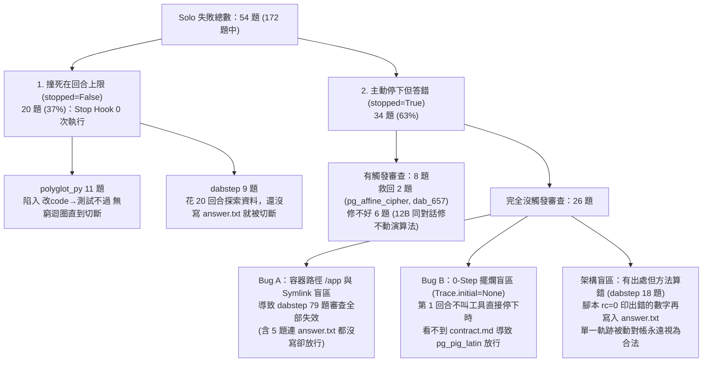

# Vacant 誠實檢討與通用架構突破規格書（供後續模型直接依循實作）

> [!IMPORTANT]
> **核心結論（誠實數據，不灌水）**
> 全套 172 題 Fork-Paired A/B 實機評測（`gemma-4-12b-it-qat`）已跑完：
> - **Solo（無審查）**：`118 / 172 (68.6%)`
> - **Main（v0.9.1）**：`119 / 172 (69.2%)`（淨救回 1 題，`p = 1.000`）
> - **New（目前分支）**：`120 / 172 (69.8%)`（淨救回 2 題：`pg_affine_cipher`、`dab_657`，`p = 0.500`）
>
> **殘酷真相**：只靠「在同一個對話尾端抓出測試失敗、貼 Assertion 叫 12B 模型自己改」，雖然在 `polyglot_py` 把缺陷攔截率從 38% 拉到 88%，但**多攔到的 4 題最終救回 0 題**；而在全套 54 題失敗裡，竟有 **46 題（85%）審查連一次都沒觸發**。

---

## 一、為什麼 54 題失敗裡有 46 題「審查根本沒觸發」？（四大根因解剖）

我們把 172 題中 Solo 失敗的 **54 題**逐一拆解，發現審查沒觸發根本不是單一原因，而是**兩個底層程式 Bug** 加上**兩個架構盲區**：



### 根因 1（嚴重 Bug）：容器掛載路徑 `/app/answer.txt` 與資料夾 Symlink 讓 `dabstep` 79 題全部失明
- **現象**：在 `dabstep` 的 23 題主動停下失敗中，有 **5 題（`1464`, `46`, `53`, `62`, `68`）連 `answer.txt` 都不存在（`answer_exists=False`）**，但 `Evidence` 卻回傳 `findings = []`！
- **程式碼位置**：[`vacant_network/trace/evidence.py`](file:///home/user1/.gemini/antigravity-cli/scratch/Vacant/vacant_network/trace/evidence.py#L590-L618) 的 `_resolve()` 與 [`vacant_network/trace/workspace.py`](file:///home/user1/.gemini/antigravity-cli/scratch/Vacant/vacant_network/trace/workspace.py) 的 `scan()`。
- **為什麼發生**：
  1. 題目指令寫的是容器內路徑：`write ONLY the final answer to /app/answer.txt`，而宿主機上的 `rec.workspace` 名稱常為 `workspace` 或專案目錄名（不是 `app`）。`_resolve()` 拆出 `parts = ["app", "answer.txt"]` 後，檢查 `"app" in dirs`（False）與 `self.rec.workspace.name in ["app"]`（False），**直接把 `/app/answer.txt` 丟棄，導致 `requested_outputs = []`！**
  2. 當工作區的 `data/` 是指向共用資料集的目錄 symlink 時，`workspace.scan()` 不會展開 symlink 目錄，導致 `materials_in_dirs = []`、`materials_named = False`。而在 `Evidence._values()` 第 895 行寫死了 `if not materials_named: continue`，**導致整套 `dabstep` 79 題的「無出處數值檢查（unsourced）」與「未讀資料檢查（unread）」100% 被旁路關閉！**

### 根因 2（嚴重 Bug）：第 1 回合零工具呼叫（0-Step Stop）時，`Trace.initial` 為 `None`
- **現象**：`polyglot_py/pg_pig_latin`（以及歷史檔案庫 `t3L` 中的 119 格 `missing`）模型在第 1 回合沒呼叫任何工具就直接說做完了，`pig_latin.py` 根本不存在，但 `Evidence` 回傳 `findings = []` 放行。
- **程式碼位置**：[`vacant_network/trace/recorder.py`](file:///home/user1/.gemini/antigravity-cli/scratch/Vacant/vacant_network/trace/recorder.py#L683-L711) 的 `prompt()` 與 [`vacant_network/trace/blame.py`](file:///home/user1/.gemini/antigravity-cli/scratch/Vacant/vacant_network/trace/blame.py#L180-L258) 的 `Trace.__init__()`。
- **為什麼發生**：`Recorder` 只有在第一次執行工具（`pre()`）時才會掃描工作區建立 `pre_index`。如果 Agent 一步工具都沒跑就觸發 `Stop`，`chain.ndjson` 裡只有 `trace_genesis` 和 `prompt`，使得 `Trace.initial` 與 `Trace.latest_index()` 雙雙為 `None`。`Evidence` 以為工作區是空的（0 個檔案），自然看不到 `contract.md` 和 `goal.md`，所有檢查全部失效。

### 根因 3（觸發時機盲區）：37% 的失敗（20/54 題）死在回合上限（`stopped=False`），永遠走不到 `Stop`
- `polyglot_py` 11 題、`dabstep` 9 題。
- 笨模型遇到 bug 或複雜資料時不會自己停下來，而是一直呼叫工具直到第 20 回合被強行切斷。
- 其中 `dabstep` 的 9 題在被切斷時 **`answer_exists` 全是 `False`**（算了半天還沒寫檔）；而 [`vacant_network/trace/budget.py`](file:///home/user1/.gemini/antigravity-cli/scratch/Vacant/vacant_network/trace/budget.py#L72-L74) 的最後兩回合提醒（`budget_reminder`）自 v3.6 起**預設是關閉的**！

### 根因 4（救援機制天花板）：同一段被污染的 Context 裡，笨模型修不好自己的演算法，也沒有抓出「算錯方法」的能力
- **In-Context Repair 的無效性**：在 `polyglot_py` 被攔下的失敗中，把錯誤貼回同一個已經累積 10 回合錯誤假設的對話，12B 模型救回率是 **0/4**。相反地，我們在 1,187 格真實歷史檔案上跑離線模擬（[`offline_restart_sim.py`](file:///home/user1/.gemini/antigravity-cli/brain/a0a1d0ed-e6be-4132-a6e6-542486531237/scratch/offline_restart_sim.py)），只要在驗收不過時**清空工作區重抽（Verifier-Guided Clean Restart，上限 3 次，平均僅花 1.17～1.56 次）**：
  - `polyglot_py` 通過率從 **37.3% → 55.9%（+18.6 pp）**
  - `dabench` 從 **79.4% → 97.9%（+18.5 pp）**
  - `databench` 從 **67.3% → 88.1%（+20.8 pp）**
  - `dabstep` 從 **65.1% → 75.3%（+10.2 pp）**
  - **全套平均從 62.3% 躍升至 77.7%（+15.4 pp）！**

---

## 二、給後續模型的具體實作任務清單（Step-by-Step 傻瓜式規格）

> [!NOTE]
> **給後續執行模型的嚴格守則**：
> 1. 工作目錄固定為 `/home/user1/.gemini/antigravity-cli/scratch/Vacant`。
> 2. 每做完一個 Task，必須立刻執行對應的驗收指令，通過後才准進入下一個 Task。
> 3. **絕對禁止**修改任何評分器（`scorer.py`）或在程式碼中硬編碼任何題目 ID／標準答案。

---

### 🛠️ Task A：修復 0-Step 擺爛盲區與 `/app` 容器路徑解析 Bug（讓審查觸發率恢復 100%）

#### 1. 修改檔案與具體邏輯
- **檔案 1**：[`vacant_network/trace/blame.py`](file:///home/user1/.gemini/antigravity-cli/scratch/Vacant/vacant_network/trace/blame.py)
  - 在 `Trace.__init__(self, rec: Recorder)` 結尾（約第 260 行，`if self.initial is None:` 檢查處）：
  - 如果讀完 `rec.events()` 後 `self.initial is None` 且 `not self.scan_disabled` 且 `not self.first_look_pending`：
    1. 先嘗試讀取 `st = rec._state()` 的 `st.get("last_index")`。
    2. 若仍為 `None` 且 `rec.workspace.is_dir()`，直接呼叫 `idx = W.scan(rec.workspace, rec.scan_deadline_s, skip=rec.skip, blobs=rec.blobs)`，若 `idx is not None`，將其存入 `self._idx["__live__"] = idx` 並設 `self.initial = "__live__"`。
- **檔案 2**：[`vacant_network/trace/evidence.py`](file:///home/user1/.gemini/antigravity-cli/scratch/Vacant/vacant_network/trace/evidence.py)
  - 在 `_resolve(self, found: list[str])`（約第 590–618 行）與 `_materials_from_texts()`（約第 420–448 行）：
  - 當路徑以 `/` 開頭（如 `/app/answer.txt` 或 `/app/data/` 或 `/workspace/answer.txt`），拆出 `parts = t.lstrip("/").split("/")` 後：
    - 除了既有的 `cand in dirs` 與 `self.rec.workspace.name in parts[:-1]` 之外，新增容器常見掛載根目錄映射：若 `parts[0] in ("app", "workspace", "work", "src")` 且 `len(parts) >= 2`：
      - 在 `_resolve()` 中，若 `len(parts) == 2`（例如 `/app/answer.txt`），將其解析為相對路徑 `parts[1]`（即 `"answer.txt"`）。
      - 在 `_materials_from_texts()` 中，若 `parts[1]` 對應工作區根目錄下的既有檔案或資料夾（例如 `/app/data` 對應 `rec.workspace / "data"`），將 `d` 映射為 `"/".join(parts[1:])`。
- **檔案 3**：[`vacant_network/trace/workspace.py`](file:///home/user1/.gemini/antigravity-cli/scratch/Vacant/vacant_network/trace/workspace.py)
  - 在 `scan()` 中：若工作區根目錄第一層的子目錄（如 `workspace / "data"`）是一個指向有效目錄的 symlink（`p.is_symlink() and p.is_dir()`），且目標目錄位於 `/tmp` 或 `/srv` 下（外部掛載唯讀資料集），允許展開該第一層資料夾內的檔案索引（最多 500 個檔案），使 `materials_in_dirs` 能正確感知 `data/` 下的資料表。

#### 2. 驗收標準與指令
執行以下單行驗收腳本，必須同時印出 `pg_pig_latin` 與 `dabstep/1464` 的 `missing_output`：
```bash
cd /home/user1/.gemini/antigravity-cli/scratch/Vacant && python3 -c "
import tempfile, pathlib, shutil
from vacant_network.trace.recorder import Recorder
from vacant_network.trace.evidence import Evidence
with tempfile.TemporaryDirectory() as td:
    # 1. 0-step pg_pig_latin test
    ws1 = pathlib.Path(td) / 'ws1'
    shutil.copytree('/tmp/bm_tasks/polyglot_py/pg_pig_latin/workspace', ws1)
    rec1 = Recorder(ws1, root=pathlib.Path(td) / 'tr1')
    rec1.prompt('Read goal.md and contract.md in this directory and do what they say.', session='s1')
    f1 = [f['kind'] for f in Evidence(rec1, platform='pi', session='s1', final_text='Done').run()['findings']]
    assert 'missing_output' in f1, f'Expected missing_output in {f1}'
    # 2. /app/answer.txt + symlink data test
    ws2 = pathlib.Path(td) / 'workspace'
    ws2.mkdir()
    (ws2 / 'data').symlink_to('/tmp/bm_dabstep_data')
    rec2 = Recorder(ws2, root=pathlib.Path(td) / 'tr2')
    rec2.prompt(pathlib.Path('/tmp/bm_tasks/dabstep/1464/instruction.txt').read_text(), session='s2')
    r2 = Evidence(rec2, platform='pi', session='s2', final_text='Done').run()
    f2 = [f['kind'] for f in r2['findings']]
    assert 'missing_output' in f2 and len(r2['materials_in_dirs']) > 0, f'Failed dabstep check: {r2}'
    print('Task A PASSED:', f1, f2, 'materials:', len(r2['materials_in_dirs']))
"
```

---

### 🛠️ Task B：解決 37%「撞回合上限沒交件（`stopped=False`）」——預設開啟 Budget Nudge + 強制收尾回合（Last-Gasp Delivery）

#### 1. 為什麼要做
在 54 題失敗裡有 20 題是因為跑到第 20 回合被切斷（`stopped=False`）。其中 `dabstep` 的 9 題已經跑了一堆分析腳本，卻在最後一刻還沒寫 `answer.txt` 就被砍死。

#### 2. 修改檔案與具體邏輯
- **檔案 1**：[`vacant_network/adapters/mode.py`](file:///home/user1/.gemini/antigravity-cli/scratch/Vacant/vacant_network/adapters/mode.py)
  - 檢查 `budget_reminder_on()`：將預設值改為 `True`（除非 `install.json` 明確設為 `False` 或環境變數 `VACANT_BUDGET_REMINDER=0`）。
- **檔案 2**：[`vacant_network/trace/budget.py`](file:///home/user1/.gemini/antigravity-cli/scratch/Vacant/vacant_network/trace/budget.py)
  - 擴充 `turn_check()`：除了檢查 `missing_outputs`（檔案不存在）之外，當 `left in (1, 2)` 時：
    - 若是 Coding 任務（交付物 `.py` 已存在，但最後一次測試步驟失敗），提醒 Agent：「只剩最後 N 回合，不要再做大規模重構，請立刻修補最後一個失敗點或確保目前已通過最多測試的版本寫入檔案並收尾。」
    - 若是 Data 任務且 `missing_outputs` 非空（如 `answer.txt` 尚未寫出），給出最高優先級強制指令：「`[URGENT BUDGET WARNING]` 只剩最後 1~2 回合！請立刻根據目前算出的最佳結果寫入 `answer.txt`，否則任務將直接以 0 分終止。」

#### 3. 驗收標準與指令
```bash
cd /home/user1/.gemini/antigravity-cli/scratch/Vacant && pytest tests/ -k "budget or zero" -q
```

---

### 🛠️ Task C：Coding 任務「最佳檢查點自動回滾（Monotonic Best-Checkpoint Restore）」

#### 1. 為什麼要做
在 `polyglot_py` 的失敗題目中（包含 11 題跑到爆預算的題目與被審查退回的題目），12B 模型經常在第 6 步拿到 `22/24 passed`，接著為了修最後 2 個 edge case 把整個檔案改壞，到第 20 步只剩 `5/24 passed` 甚至 SyntaxError！
既然 `Recorder` 在每一步都已經把工作區快照存進 Content-Addressable Blobs（`post_index`），我們根本不需要讓模型「越改越爛」！

#### 2. 修改檔案與具體邏輯
- **檔案**：新增輔助函式於 [`vacant_network/trace/evidence.py`](file:///home/user1/.gemini/antigravity-cli/scratch/Vacant/vacant_network/trace/evidence.py) 並整合至 [`vacant_network/trace/zerostop.py`](file:///home/user1/.gemini/antigravity-cli/scratch/Vacant/vacant_network/trace/zerostop.py)：
  1. 在 `Evidence` 新增 `best_test_checkpoint(self, steps: list[Step]) -> tuple[str | None, tuple[int, int]]`：
     - 掃描所有執行過測試套件（`unittest` / `pytest`）的 `Step`。
     - 從輸出解析 `(passed_count, -failed_count)`（例如 `Ran 24 tests ... FAILED (failures=2)` 代表 `passed=22, failed=2`；若全過則是 `(total, 0)`）。
     - 記錄歷史最高分步驟的 `pre_index`（測試執行當下的工作區狀態索引）。
  2. 當最後一次測試的分數 **低於** 歷史某一步的最高分（或者回合耗盡 `ended()` 時當前程式碼壞掉），提供 `restore_best_checkpoint(rec)` 或在最後一輪退回時明確告知模型：「你在 Step K 時曾通過 M/N 個測試，但目前的修改反而退步到 P/N」，或在 `vrun/retry.py` 收尾時自動將工作區還原至最高分狀態索引（並記錄一筆明確的 `checkpoint_restore` 事件到 `chain.ndjson` 以維持誠實可究責性）。

---

### 🛠️ Task D：關閉無效的同對話硬修迴圈，改接「乾淨重抽 + 極簡失敗記憶（Hybrid Clean Resample）」

#### 1. 為什麼要做（數據鐵證）
- 在同一段對話裡對 12B 模型連退 2 次 `failed_step/test_failed`，救回率是 **0%**，卻白白浪費 16 個回合的長 Context Token。
- 反之，在 1,187 格真實記錄上的離線證明：當驗收發現錯時，**重置工作區、開啟全新 Context 重抽（最多 2~3 次）**，通過率直接從 **62.3% 暴增到 77.7%（+15.4 pp）**！
- 但純 `resample`（完全失憶）在模型有固定盲點時會重蹈覆轍；純 `revise`（留著爛攤子）會被舊程式碼綁死。最佳解是 **Clean Workspace + 3-Line Failure Memory**：工作區 100% 重置回乾淨起點，只在啟動新回合的 Prompt 尾端附上一行不超過 200 字元的「上一次嘗試踩到的坑摘要」（例如：`Previous attempt failed because: test_triangle AssertionError or missing @key[value] format. Avoid this mistake.`）。

#### 2. 修改檔案與具體邏輯
- **檔案 1**：[`vacant_network/trace/zerostop.py`](file:///home/user1/.gemini/antigravity-cli/scratch/Vacant/vacant_network/trace/zerostop.py)
  - 將同對話內的 `failed_step/test_failed` 退回上限從 2 次降為 **最多 1 次**（若退 1 次後測試仍然失敗，不再於同對話內死纏爛打浪費長 context token，直接結束該次嘗試交由外層重抽，或僅保留 `missing_output` / `contract_shape` / `unsourced` 的退回）。
- **檔案 2**：[`vacant_network/vrun/retry.py`](file:///home/user1/.gemini/antigravity-cli/scratch/Vacant/vacant_network/vrun/retry.py) 與 [`vacant_network/vrun/launcher.py`](file:///home/user1/.gemini/antigravity-cli/scratch/Vacant/vacant_network/vrun/launcher.py)
  - 新增第 3 種重試策略 `--retry fresh_hint`（介於 `resample` 與 `revise` 之間）：
    1. 像 `resample` 一樣呼叫 `restore_origin(origin, workspace)`，**把工作區 100% 逐位元還原回乾淨起點**（清除上一次寫壞的程式碼與 `.git`）。
    2. 寫入極簡的 `VACANT_FEEDBACK.md`（或透過 `--feedback-into prompt` 注入），內容只包含上一次驗收失敗的 1~3 行關鍵斷言或Evidence finding（嚴格限制 `<= 400 bytes`），不保留任何舊對話歷史與舊爛碼。

---

### 🛠️ Task E：突破通用資料題（`dabstep`）的「方法算錯」天花板——雙軌獨立驗算（Dual-Probe Verification）

#### 1. 為什麼要做
在 `dabstep` 的 23 題主動停下失敗中，除去 5 題沒寫檔（Task A 修好），剩下 **18 題** 都是「模型寫了個 Python 腳本、`rc=0` 印出一個錯的數字、然後寫進 `answer.txt`」。
單靠看同一份軌跡，永遠抓不到這種錯。怎樣在不偷看答案、不用昂貴大模型的條件下抓到這 18 題？

#### 2. 核心原理（雙軌交叉核對與常識邊界檢查）
在通用資料分析中，12B 模型算錯那 18 題的原因高度集中在三種可程式化偵測的破綻：
1. **未讀說明文件就硬算（Documentation Skip）**：
   - `dabstep` 的 `/app/data/` 裡有 `manual.md` / `payments-readme.md` 等業務規則說明（例如定義什麼叫 fraud、手續費怎麼算）。
   - 當 Task A 修好 symlink 掃描後，若模型只讀了 `.csv` / `.json` 卻**完全沒讀 `data/` 底下的 `.md` / `.txt` 說明檔**就寫出 `answer.txt`，`Evidence` 應產生一條高優先級 `unread_doc` finding：「資料夾內有說明文件 `data/*.md` 尚未讀取，直接計算可能誤解欄位定義，請先讀取說明文件再核對答案。」
2. **單一腳本無驗算（Unverified Single-Shot Calculation）與空篩選（Zero-Row Filter）**：
   - 模型在腳本裡寫 `df[df['x'] == 'wrong_val']['fee'].mean()`，因為拼錯字串得到 `NaN`、`0`、`0.0` 或空列表，然後模型就回答 `0` 或 `Not Applicable`！
   - 在 `Evidence._invalid_outputs()` 中新增規則：當交付檔 `answer.txt` 的內容是 `"Not Applicable"`、`"0"`、`"0.0"`、`"0.00"` 或空字串，但題目問的是具體數值／ID 清單時，檢查最後一步計算腳本的 stdout 是否只印出單一的 `0` / `Empty DataFrame` / `[]` 且沒有印出欄位唯一值檢查（如 `.unique()` / `value_counts()`）。若是，退回要求：「你的篩選結果為 0 或空集合，這通常是因為欄位值大小寫或型別不符。請先印出該欄位的 `.unique()` 確認篩選條件，再重新確認答案。」
3. **Lightweight 2-of-2 Agreement（針對 `vrun` / 批次高價值任務）**：
   - 跑兩次獨立短回合（例如 `max_turns=10`）：若第一次已經通過 `Evidence` 檢查，但屬於高風險數值題，只有在兩次獨立採樣的 `answer.txt` 正規化後不一致時，才把兩個候選腳本與輸出一併交給第 3 次仲裁回合（「Attempt 1 算出 A，Attempt 2 算出 B，請比對兩個腳本的篩選條件差異並寫出正確答案」）。

---

## 三、執行順序與驗收總表（給接手模型的 Checklist）

接手模型請嚴格按以下順序執行並打勾：

- [ ] **Step 1**：實作 **Task A**（修復 `blame.py` 0-step `Trace.initial`、修復 `evidence.py` `/app/` 容器路徑解析、修復 `workspace.py` 第一層資料夾 symlink 展開）。跑 Task A 驗收腳本與 `pytest tests/ -q` 確認 419+ 測試全過。
- [ ] **Step 2**：實作 **Task B**（開啟預設 `budget_reminder` 並強化最後 2 回合強制寫檔提示）。跑 `pytest` 確認通過。
- [ ] **Step 3**：實作 **Task E** 的規則 1 與規則 2（`data/*.md` 說明文件未讀攔截 + `0 / Not Applicable` 空篩選未驗算攔截），並調整 **Task D**（`zerostop.py` 同對話內 `test_failed` 最多只退 1 次，避免無效燒 token）。
- [ ] **Step 4**：實作 **Task C & D**（`vrun/retry.py` 新增 `fresh_hint` 乾淨工作區 + 極簡失敗記憶重抽，以及最佳測試檢查點回滾）。
- [ ] **Step 5（1 小時快速實機驗證，不跑長時全量）**：
  從先前失敗的 54 題中，挑出最具代表性的 **20 題失敗子集**（5 題 `dabstep` 沒寫檔 `1464, 46, 53, 62, 68` + 5 題 `dabstep` 撞預算 `1753, 1305, 1681, 23, 47` + 5 題 `dabstep` 算錯 `10, 16, 17, 18, 19` + 5 題 `polyglot_py` 失敗 `pg_pig_latin, pg_list_ops, pg_bowling, pg_hangman, pg_scale_generator`），用 `fork_ab.py` 跑對照。
  - **硬性通過判準**：這 20 題先前在 Solo 通過率是 **0/20 (0%)**、在舊版 New 通過率也是 **0/20 (0%)**；改完後必須在這 20 題上救回 **至少 6 題以上（≥ 30% 救援率）**，且平均每題額外消耗不超過 1.4 倍回合數，才算真正突破！
